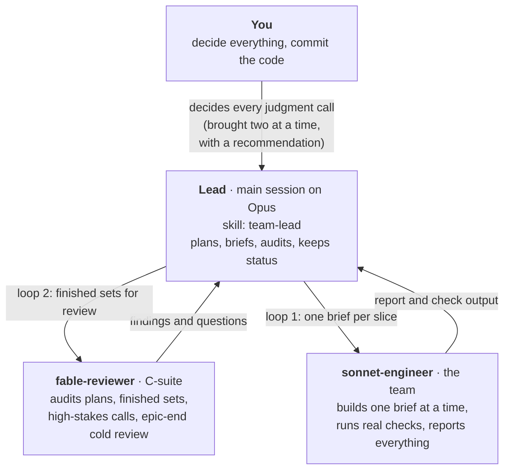

# team-lead

A multi-agent build protocol for [Claude Code](https://claude.com/claude-code). It runs a build the way a small, careful company would:

- **Opus** is the lead. It plans, slices the work, briefs the engineers and audits what they deliver.
- **Fable** is the C-suite reviewer. It audits the lead's work, never edits a file and never decides.
- **Sonnet** engineers build. Each one carries out one self-contained brief and reports back.
- **You** decide everything. Every judgment call comes to you, two at a time, with a recommendation.



## What's in the box

| Path | What it is |
|---|---|
| `skills/team-lead/SKILL.md` | The protocol the lead follows: roles, the two review loops, decision rules, how to brief, how to check work, and the standing rules every brief carries. |
| `skills/team-lead/kickoff-template.md` | A fill-in-the-blanks kickoff prompt that starts a build with this protocol. |
| `agents/fable-reviewer.md` | The reviewer subagent. Read-only, high effort, ranked findings, judgment calls marked FOR THE HUMAN. |
| `agents/sonnet-engineer.md` | The engineer subagent. Works only from the brief, runs real checks and reports in a fixed format. |

## How it works

**Loop 1: lead and engineers.** The lead briefs a Sonnet engineer per slice. When several slices are done, the lead audits them as a batch by reading the diffs, re-running the tests and comparing against the acceptance criteria. It sends feedback to the same engineer until every slice passes.

**Loop 2: reviewer and lead.** When the lead has finished and accepted a whole set of related work, it brings that set to Fable. Fable audits it against the design pack and the code, and they loop until Fable accepts it. Fable also reviews the slice plan before the first brief, advises when the lead is stuck, weighs high-stakes calls, and gives a fresh, cold review at the end of each epic.

**Guardrails that make it safe to run on a real codebase:**
- Nobody but you stages, commits, pushes or deploys.
- Any change to an existing file is shown to you as a diff and applied only after you approve.
- Files written by other people aren't edited. New code goes beside them and is recorded in a handover doc.
- Tests assert the spec, not the code. A red test is a finding, never something to weaken.
- A difference between the code and the design pack is always reported, never fixed silently.

## Install

### As a plugin (recommended)

In Claude Code:

```
/plugin marketplace add Salimboevm/team-lead
/plugin install team-lead@team-lead
```

### By hand

Copy the files into your user or project Claude folder:

```bash
git clone https://github.com/Salimboevm/team-lead.git
mkdir -p ~/.claude/skills ~/.claude/agents
cp -R team-lead/skills/team-lead ~/.claude/skills/
cp team-lead/agents/*.md ~/.claude/agents/
```

Use `.claude/` inside a repo instead of `~/.claude/` to scope it to one project.

## Use it

1. Start Claude Code on Opus at high effort, in the repo you're building in.
2. Open `skills/team-lead/kickoff-template.md`, fill in the placeholders (your design pack, branches, epics and project rules) and paste it as your first message.
3. The lead stops for you only at: the inventory report, blockers, the slice plan, each change to an existing file, judgment calls (two at a time) and the end of each epic.

For smaller jobs you can skip the template. Say "load the team-lead skill and run this as the lead" and describe the work.

## Make it yours

- **Project rules.** The skill has a `Project rules` section with examples. Put your own in your project's `CLAUDE.md` or in the kickoff prompt, each as a bold rule followed by a one-line *Why*. Rules that came from real incidents are the most useful.
- **Models.** The agents ask for `model: fable` and `model: sonnet` in their frontmatter. If your plan doesn't include a model, change it to one you can use. The protocol still works, though a weaker reviewer catches less.
- **Review length.** Fable keeps reviews under 800 words unless the lead sets a limit.

## Requirements

- Claude Code with subagent support.
- Access to the Opus, Fable and Sonnet models, or edit the agents' `model` lines as above.

## Licence

[MIT](LICENSE)
